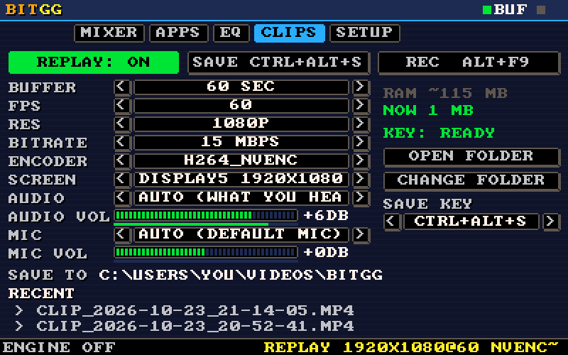
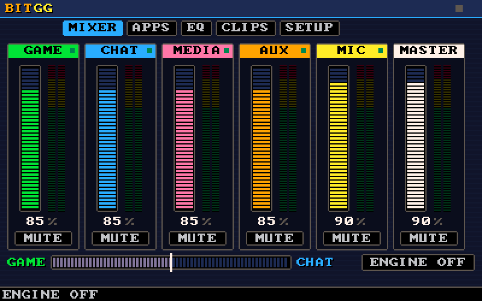
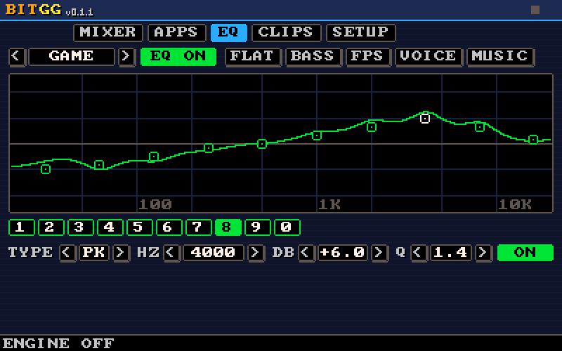

# BitGG

**โปรแกรม native ขนาดจิ๋วสำหรับ Windows ที่มาแทน 2 ส่วนของ SteelSeries GG ที่ใช้กันจริงทุกวัน คือ Sonar (จัดการเสียง / แยกเสียงรายแอป / EQ / ไมค์) กับ Moments (อัดย้อนหลัง + อัดหน้าจอ)** หน้าตาเป็น pixel art 8-bit วาดเองทั้งหมด ไม่ใช้ GPU, ไม่ใช้ Electron, ไม่ใช้ .NET

🇬🇧 English: [README.md](README.md)

<p align="center">
  
</p>

| Mixer | Parametric EQ |
|---|---|
|  |  |

| | RAM | CPU (ว่าง) |
|---|---|---|
| เปิดหน้าต่าง BitGG | ~26 MB | ~0 % |
| BitGG + replay 30 วิ ที่ 1080p60 | ~26 MB + บัฟเฟอร์คลิป (~60 MB) | <1 % |
| SteelSeries GG (เทียบบนเครื่องเดียวกัน) | ~740 MB | — |

ทั้งโปรแกรมเป็นไฟล์ `.exe` เดียว ขนาดราว 1 MB ไม่ต้องลงอะไรเพิ่ม

> **โปรเจกต์อิสระ ไม่เป็นทางการ** ไม่เกี่ยวข้องกับ SteelSeries ใช้แค่ *อุปกรณ์เสียงเสมือน* ของ Sonar ที่ GG ลงไว้ในเครื่องอยู่แล้ว ไม่ได้แถมหรือแก้ไข driver ของ SteelSeries

---

## วิธีติดตั้ง (ง่ายมาก)

BitGG เป็นแบบ **portable** คือไม่ต้องติดตั้ง และไม่ต้องใช้สิทธิ์ admin เลย

1. โหลด **[BitGG.exe](https://github.com/PUTTIPONG-Boss/BitGG/releases/latest/download/BitGG.exe)** (ลิงก์นี้ได้เวอร์ชันล่าสุดเสมอ ส่วนทุกเวอร์ชันอยู่ในหน้า [Releases](../../releases))
2. ดับเบิลคลิกเปิด หน้าต่างจะขึ้นมาและใช้งานได้ทันที
3. (ถ้าต้องการ) ไปแท็บ **SETUP** กด **ADD SHORTCUTS** เพื่อสร้างไอคอนบน Desktop และ Start Menu หรือเปิด **STARTUP** เพื่อให้เปิดเอง (เข้าไปอยู่ใน tray) ตอน login

การตั้งค่าเก็บที่ `%APPDATA%\BitGG\config.json` คลิปเก็บที่ `Videos\BitGG` โดยปริยาย (เปลี่ยนได้ในแท็บ CLIPS)

### อัปเดต

BitGG อัปเดตตัวเองได้ พอมี release ใหม่ มันจะดาวน์โหลดเบื้องหลัง ตรวจกับค่า SHA-256 ของ release แล้วขึ้นปุ่ม **UPDATE vX.Y.Z** กะพริบข้างโลโก้ (และมีแจ้งเตือนที่ tray) กดปุ่มแล้ว BitGG จะคืนค่าเสียงให้ปกติ สลับไฟล์ exe แล้วเปิดเวอร์ชันใหม่ขึ้นมาเอง การตั้งค่ายังอยู่ครบ

การเช็กคือส่งคำขอเดียวไปที่ release API ของ GitHub ตอนเปิดโปรแกรม และทุก 6 ชั่วโมง ไม่ได้ส่งข้อมูลอะไรเกี่ยวกับคุณหรือเครื่องคุณออกไป ปิดได้ที่ **SETUP → UPDATES** ถ้าปิดไว้ หรือยังใช้ v0.1.0 (ก่อนมีระบบอัปเดต) ให้โหลด `BitGG.exe` ตัวใหม่มาวางทับตัวเดิม

### ถ้าเจอ "Windows protected your PC" หรือ antivirus เตือน

BitGG เป็น open source และสะอาด แต่เป็นโปรแกรม native ตัวใหม่ที่ **ยังไม่ได้เซ็นชื่อ (unsigned)** และมีการจับภาพหน้าจอ Windows SmartScreen หรือ antivirus บางตัวเลยอาจเตือนตอนเปิดครั้งแรกจนกว่าไฟล์จะมีชื่อเสียงพอ อันนี้เป็น false positive แก้ได้โดย

- บนหน้าต่าง SmartScreen กด **More info → Run anyway** หรือ
- **build เองจาก source** (ดูด้านล่าง) จะได้รันโค้ดที่อ่านเองได้ทุกบรรทัด หรือ
- ตรวจไฟล์ที่โหลดมา: ทุก release มีค่า SHA-256 และ build โดย GitHub Actions พร้อม provenance attestation ที่เซ็นรับรองไว้ ถ้ามี [GitHub CLI](https://cli.github.com) ตรวจได้ด้วย `gh attestation verify BitGG.exe -R PUTTIPONG-Boss/BitGG`

BitGG ไม่ obfuscate หรือ pack ไฟล์ ไม่ส่งข้อมูลเกี่ยวกับคุณออกไป (ใช้เน็ตแค่ตอนเช็กอัปเดต ซึ่งปิดได้) และฟีเจอร์เดียวที่ดูเหมือน keylogger คือ global keyboard hook นั้น **ปิดไว้โดยปริยาย** ดูหัวข้อ [ปลอดภัยไหม](#ปลอดภัยไหม) ด้านล่าง

---

## ทำอะไรได้บ้าง

### เสียง (ส่วน Sonar)
- **5 แถบ** — Game / Chat / Media / Aux / Mic บวก Master แต่ละแถบมี fader, mute และมิเตอร์แบบสด
- **แยกเสียงรายแอป (แท็บ APPS):** ส่งแต่ละโปรแกรมไปคนละช่อง เช่น เกม → GAME, Discord → CHAT ใช้ API ลับของ Windows ตัวเดียวกับที่ Sonar ใช้
- **EQ 10 band (แท็บ EQ):** ลากจุดบนกราฟได้ หมุน wheel ปรับ Q มี preset (Flat / Bass / FPS / Voice / Music) ใช้ได้ทั้งรายช่องและไมค์
- **ChatMix:** สไลเดอร์เดียวปรับสมดุลเสียงเกมกับแชท
- **ไมค์:** มี noise gate + EQ
- **2 โหมด สลับอัตโนมัติ:**
  - **DSP** (จุดเขียว) — เมื่อช่องชี้ไปที่ *อุปกรณ์เสียงเสมือน* (VAD ของ Sonar หรือเช่น VB-Cable) เสียงจะไหลผ่านและถูกประมวลผลเต็มรูปแบบ (EQ, gate, mix)
  - **DIRECT** (จุดม่วง) — เมื่อไม่มีอุปกรณ์เสมือน fader จะไปปรับระดับเสียงจริงของแอปที่จัดเข้าช่องนั้น ไม่มี EQ แต่ใช้ได้เลยไม่ต้องตั้งค่าอะไร
- **ใช้อุปกรณ์เสมือนของ Sonar โดยไม่ต้องเปิด GG:** ปุ่ม **ENABLE SONAR VADS** ในแท็บ SETUP จะเปิดอุปกรณ์เสมือนของ Sonar (ที่ถูก disable ไว้) กลับมาโดยไม่ต้องใช้ admin จึงได้ EQ/routing ครบโดยไม่ต้องเปิด GG ที่กิน 700 MB

### คลิป (ส่วน Moments)
- **Replay buffer:** อัดวนเก็บ *N* วินาทีล่าสุด (15–300 วิ) ไว้ใน RAM ตลอดเวลา บีบอัดด้วยการ์ดจอ (NVENC / Quick Sync / AMF) ผ่าน Windows Media Foundation — **ไม่ต้องใช้ FFmpeg**
- **เซฟย้อนหลัง N วินาทีได้ทันที:** กดปุ่ม (ค่าเริ่มต้นเลือกให้อัตโนมัติ เช่น **Ctrl+Alt+S**) ได้ *ขณะอยู่ในเกม* หน้าต่างอยู่ใน tray ก็ได้ การเซฟเป็นการตัดต่อแบบ copy (ไม่ encode ใหม่) ใช้เวลาราว 0.1 วิ และมีเสียงยืนยัน
- **โหมด Record:** อัดยาวแบบกด start/stop เป็นไฟล์ MP4
- **เลือกได้ว่าจะอัดเสียงอะไร:** เลือกอุปกรณ์เสียง + ปรับความดัง และเลือกไมค์ + ปรับความดัง แต่ละตัวมีแถบระดับเสียงสด และมีตัวจำกัดเสียงกันแตก
- เปลี่ยนโฟลเดอร์เซฟ, ปุ่มเซฟ, ความละเอียด, fps, bitrate, encoder และจอ ได้ในแท็บ CLIPS

### อยู่ใน tray
กด minimize หรือ **X** → BitGG จะเข้าไปอยู่ใน system tray และทำงานต่อ (engine + replay ยังอยู่) คลิกซ้ายที่ไอคอนเพื่อเปิดกลับมา คลิกขวาเพื่อเปิดเมนู (Open / Save clip / Replay on-off / Exit) เปิดโปรแกรมซ้ำจะเป็นการเรียกหน้าต่างเดิมขึ้นมา

---

## Build จาก source

ต้องมี [Rust toolchain](https://rustup.rs) (stable) ใช้ MSVC หรือ GNU ก็ได้

```sh
git clone https://github.com/PUTTIPONG-Boss/BitGG.git
cd BitGG
cargo build --release
```

ไฟล์ที่ได้อยู่ที่ `target/release/bitgg.exe`

- ไอคอนฝังด้วย `build.rs` ผ่าน **windres** (มากับ MinGW) ถ้าไม่มี windres (เช่นใช้ MSVC ล้วน) ก็ build ผ่านอยู่ แค่ไม่มีไอคอนฝัง
- ถ้า path ของโปรเจกต์ยาวเกิน (`MAX_PATH` ของ Windows) ให้ชี้ output ไปที่สั้น ๆ โดยสร้าง `.cargo/config.toml` ใส่ `[build]` กับ `target-dir = "C:/bitgg-target"`

---

## Branch และการออก Release (สำหรับคนดูแลโปรเจกต์)

| Branch | ใช้ทำอะไร |
|---|---|
| `main` | **ไว้ออก release อย่างเดียว** tag `v*` ทุกตัวต้องอยู่บน `main` ถ้า tag ไม่ได้อยู่บน `main` workflow จะไม่ยอมออก release |
| `master` | branch สำหรับพัฒนา งานทุกชิ้นแตกออกจากตรงนี้ |
| `<ชื่องาน>` | งานละ branch ตั้งชื่อตามงาน เช่น `code-signing`, `fix-mic-gain` |

```sh
git switch master && git pull
git switch -c fix-mic-gain        # ทำงาน, commit
git push -u origin fix-mic-gain   # เปิด PR: fix-mic-gain -> master
```

พอ `master` พร้อมออกเวอร์ชัน:

1. **เพิ่มเลขเวอร์ชัน** ใน `Cargo.toml` (ทำบน branch แล้ว PR เข้า `master`) เลขนี้คือเลขที่แสดงข้างโลโก้และบนแถบชื่อหน้าต่าง แก้บั๊กใช้ `0.1.0 → 0.1.1` เพิ่มฟีเจอร์ใหม่ใช้ `0.1.x → 0.2.0`
2. เปิด PR **`master` → `main`** แล้ว merge ส่วน driver เสียงเสมือน (`driver/`, `docs/driver/`) ยังพัฒนาอยู่บน `master` และยังห้ามออก release ถ้า merge แล้วมันติดเข้า `main` ให้เอาออก (แตก branch จาก `main` แล้ว `git rm -r driver docs/driver` จากนั้น PR เข้า `main`) workflow จะไม่ยอมออก release ถ้า commit ที่ tag ยังมี driver อยู่
3. tag บน `main` ด้วยเลข**เดียวกัน** (ถ้า tag ไม่ตรงกับ `Cargo.toml` workflow จะไม่ยอมออก release)

```sh
git switch main && git pull
git tag v0.1.1
git push origin v0.1.1
```

GitHub Actions จะ build, รันเทสต์ (รวมเทสต์กัน anti-cheat), เซ็นชื่อ (ถ้าตั้งค่าไว้) และออก release พร้อม `BitGG.exe`, `SHA256SUMS.txt` และ provenance attestation ให้เอง นอกจากนี้ CI จะ build และรันเทสต์ให้ทุก push และทุก PR

ถ้าแก้หน้าตา UI แล้วอยากอัปเดตรูปใน README ให้รัน `bitgg --screenshots <โฟลเดอร์>` โปรแกรมจะวาดหน้า CLIPS, MIXER และ EQ ด้วยการตั้งค่าตัวอย่าง (ไม่มี path หรือชื่ออุปกรณ์ส่วนตัว) ออกมาเป็น BMP แล้วแปลงเป็น PNG ใส่ใน `docs/screenshots/`

### Code signing (ไม่บังคับ)

การเซ็นชื่อทำให้หายจากสถานะ "unknown publisher" และทำให้ชื่อเสียง (reputation) ของ SmartScreen สะสมไปที่ใบรับรองของคุณ แทนที่จะต้องเริ่มนับใหม่ทุกครั้งที่ออกไฟล์ใหม่ วิธีตั้งค่าคือเพิ่ม **repository secrets** 2 ตัว (Settings → Secrets and variables → Actions):

| Secret | ค่า |
|---|---|
| `WINDOWS_CERT_PFX_BASE64` | ใบรับรอง code-signing (`.pfx`) ที่แปลงเป็น base64 |
| `WINDOWS_CERT_PASSWORD` | รหัสผ่านของไฟล์ `.pfx` |

สร้างค่า base64 ด้วย PowerShell:

```powershell
[Convert]::ToBase64String([IO.File]::ReadAllBytes("C:\path\to\cert.pfx")) | Set-Clipboard
```

ตั้ง **variable** `TIMESTAMP_URL` เพิ่มได้ (ค่าเริ่มต้น `http://timestamp.digicert.com`) ถ้าไม่ได้ใส่ secrets ก็ยังออก release ได้ตามเดิมแบบไม่เซ็นชื่อ ขั้นตอนเซ็นชื่อ ([`.github/scripts/sign.ps1`](.github/scripts/sign.ps1)) ถ้าลายเซ็นผิดจะหยุด release ทันทีแทนที่จะปล่อยไฟล์ออกไป มี timestamp ทำให้ลายเซ็นยังใช้ได้แม้ใบรับรองหมดอายุ และไม่ทิ้ง private key ไว้บนดิสก์

ใบรับรองหาได้จาก: CA สาธารณะ (OV/EV เช่น Sectigo, DigiCert, SSL.com ฯลฯ ตอนนี้ key ของ EV/OV มักต้องอยู่บน hardware token หรือ cloud HSM ซึ่งต้องใช้ขั้นตอนเซ็นอีกแบบ) หรือบริการ **Trusted Signing** ของ Microsoft ซึ่งเป็นตัวเลือกรายเดือนราคาถูกสำหรับคนทำคนเดียวหรือทีมเล็ก และต้องใช้ขั้นตอนเซ็นของมันเองแทน `.pfx` ส่วนใบรับรองแบบ self-signed **ไม่ช่วย** เรื่อง SmartScreen

> หมายเหตุ: ตั้งแต่ปี 2024 แอปที่เซ็นชื่อแล้วก็ยังอาจเจอคำเตือน SmartScreen ได้ จนกว่าใบรับรองจะมีชื่อเสียงสะสมจากการดาวน์โหลดพอ การเซ็นชื่อคือสิ่งที่ทำให้สะสมชื่อเสียงได้

---

## ปลอดภัยไหม

ปลอดภัย และออกแบบให้ตรวจสอบได้:

- **Open source ไม่ obfuscate ไม่ pack** อ่านโค้ดได้ว่ารันอะไรจริง
- **ใช้เน็ตแค่ตอนเช็กอัปเดต** ส่งคำขอ HTTPS ไปที่ release API ของ GitHub (และดาวน์โหลดตอนมีเวอร์ชันใหม่) ไม่มี analytics ไม่มีข้อมูลเกี่ยวกับคุณ ปิดได้ที่ SETUP → UPDATES
- **ไม่ต้องใช้ admin** ทำงานด้วยสิทธิ์ผู้ใช้ปกติ
- **Portable** ไม่ก๊อปตัวเองไปที่อื่น ไม่แก้ registry ปุ่ม ADD SHORTCUTS/STARTUP แค่สร้างไฟล์ `.lnk` ที่ชี้มาที่ exe ที่คุณรัน และสร้างเมื่อคุณสั่งเท่านั้น
- **keyboard hook เป็น opt-in** global keyboard hook เป็นสิ่งเดียวที่ทั้ง antivirus และผู้ใช้ควรระวัง BitGG ใช้ global hotkey ปกติแทน และถ้าปุ่มที่เลือกถูกจองไว้ก็จะเปลี่ยนไปใช้ปุ่มว่างให้เอง ตัว hook (`SETUP → KEY HOOK`) **ปิดไว้โดยปริยาย** มีไว้เผื่อกรณีหายากที่ทุกปุ่มถูกจองหมดเท่านั้น
- **ทำไมยังอาจโดนเตือน:** ไฟล์ที่ยังไม่เซ็นชื่อและใช้ API จับภาพ (Desktop Duplication / Media Foundation) ในสายตา heuristic โง่ ๆ มันดูคล้ายมัลแวร์จับหน้าจอ ทางแก้จริงคือใบ code-signing กับชื่อเสียงของไฟล์ ซึ่งทั้งคู่ใช้เวลา/เงินสำหรับโปรเจกต์งานอดิเรก การ build เองจะข้ามปัญหานี้ไปเลย

ถ้า antivirus กักไฟล์ไว้และอยากช่วย ลองส่งเป็น false positive ให้ผู้ผลิต antivirus จะช่วยให้การตรวจจับดีขึ้นสำหรับทุกคน

---

## Anti-cheat และความปลอดภัยกับเกม

BitGG ออกแบบให้ **ไม่แตะ process ของเกมเลย** ใช้แนวทาง "ทำงานจากนอกเกม" แบบเดียวกับ volume mixer และ Game Bar ของ Windows ซึ่ง*ต่าง*จาก GG Moments และ overlay ส่วนใหญ่ (GG มี `SteelSeriesGameOverlay.dll` ที่ inject เข้าไปในเกม)

| BitGG ทำอะไร | ทำผ่านอะไร | แตะเกมไหม |
|---|---|---|
| ปรับเสียง/mute/แยกเสียงรายแอป | Windows audio service (`ISimpleAudioVolume`, `AudioPolicyConfig`) | ❌ ไม่ |
| ชื่อแอปในหน้า APPS | อ่าน process snapshot ของระบบครั้งเดียว (Toolhelp) | ❌ ไม่ (ไม่เคยเปิด handle ไปที่เกม) |
| จับภาพหน้าจอ | DXGI Desktop Duplication (จับภาพหน้าจอที่ประกอบเสร็จแล้ว) | ❌ ไม่ |
| อัดเสียงเกม | WASAPI loopback ของอุปกรณ์เสียง | ❌ ไม่ |
| ปุ่ม save | `RegisterHotKey` (ระดับ OS) | ❌ ไม่ |
| keyboard hook (เสริม, **ปิด**ไว้โดยปริยาย) | `WH_KEYBOARD_LL` ทำงานใน BitGG เอง ไม่ inject | ❌ ไม่ |

ไม่มี DLL injection, ไม่อ่าน/เขียน memory ของเกม, ไม่สร้าง thread ในเกม, ไม่ hook Present/swap-chain และไม่มี overlay ในเกม มีเทสต์ [`tests/no_game_injection.rs`](tests/no_game_injection.rs) สแกน source ทุกครั้งที่ build ถ้ามี API พวกนี้โผล่มาเมื่อไร เทสต์จะ fail ทันที

**ข้อจำกัดที่ต้องบอกตรง ๆ:**
- BitGG ไม่แก้ไขเกม แต่ **EULA เป็นของแต่ละเกม** anti-cheat ระดับ kernel (Vanguard, EAC, BattlEye ฯลฯ) ไม่ flag API ข้างบน ซึ่งเป็นตัวเดียวกับที่ OBS, Discord และ Game Bar ใช้ แต่ไม่มีโปรแกรม third-party ไหน*การันตี*พฤติกรรมในอนาคตของ anti-cheat แต่ละเจ้าได้
- ถ้า anti-cheat บางเกมบล็อกการจับภาพเกมตัวเอง (เจอน้อย) คลิปจะเป็นภาพดำ ไม่มีอะไรโดน flag แค่จับภาพไม่ได้
- **KEY HOOK** (เสริม) เป็น low-level keyboard hook มาตรฐาน กลไกเดียวกับ push-to-talk ของ Discord ปิดไว้โดยปริยาย และไม่ต้องเปิด ยกเว้นกรณีที่ปุ่ม save ทุกปุ่มถูกจองหมด
- BitGG ไม่มีฟีเจอร์ GameSense / RGB และไม่คุยกับ SteelSeries Engine

## Roadmap

- **BitGG Virtual Audio driver**: อุปกรณ์เสียงเสมือนของ BitGG เอง เพื่อให้ EQ และการแยกช่องเสียงใช้ได้โดยไม่ต้องมี SteelSeries GG สเปกอยู่ที่ [docs/driver/SPEC.md](docs/driver/SPEC.md) ระหว่างที่ driver ยังไม่ได้เซ็นและยังไม่ออก BitGG ใช้อุปกรณ์ของ Sonar, VB-Cable / Voicemeeter หรือโหมด DIRECT ไปก่อน

---

## License

[MIT](LICENSE) ส่วน SteelSeries, Sonar, GG และ Moments เป็นเครื่องหมายการค้าของเจ้าของนั้น ๆ BitGG เป็นโปรเจกต์ทำงานร่วม (interoperability) แบบอิสระ
